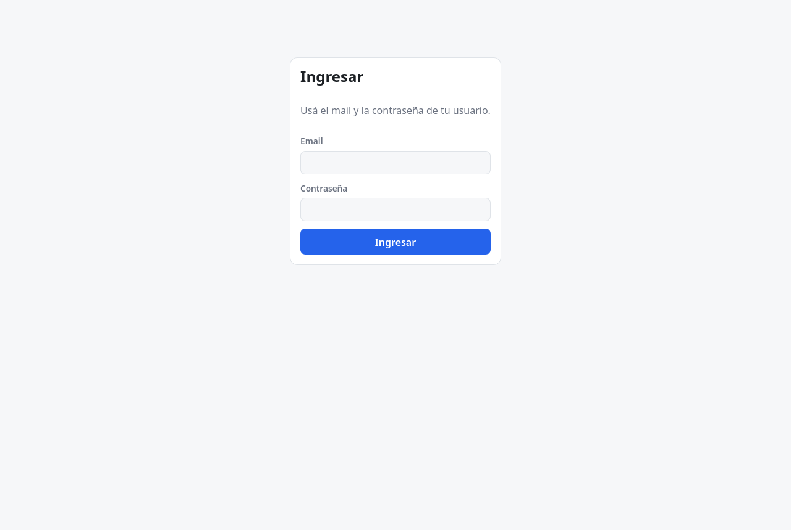
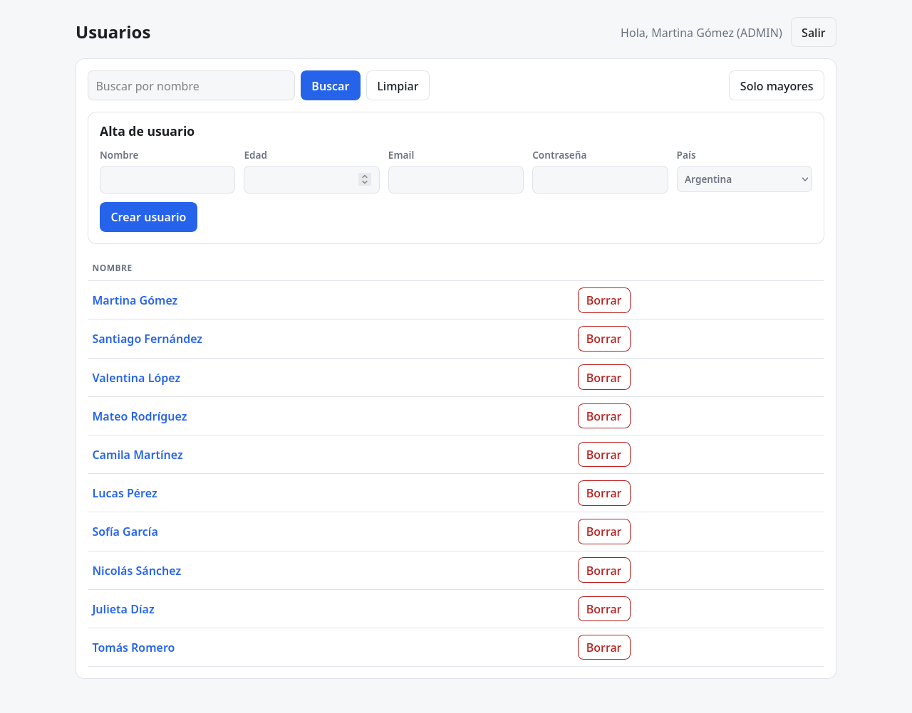
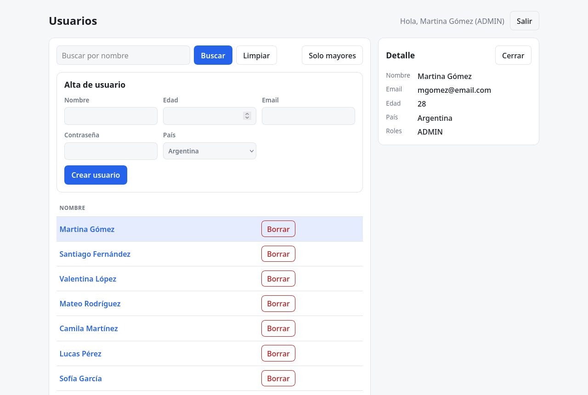
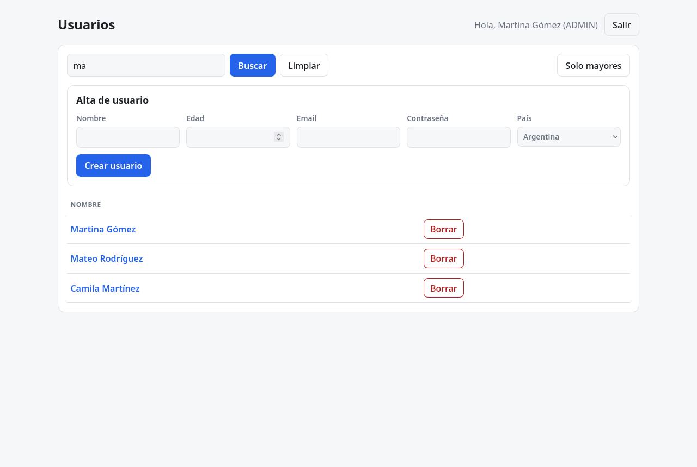
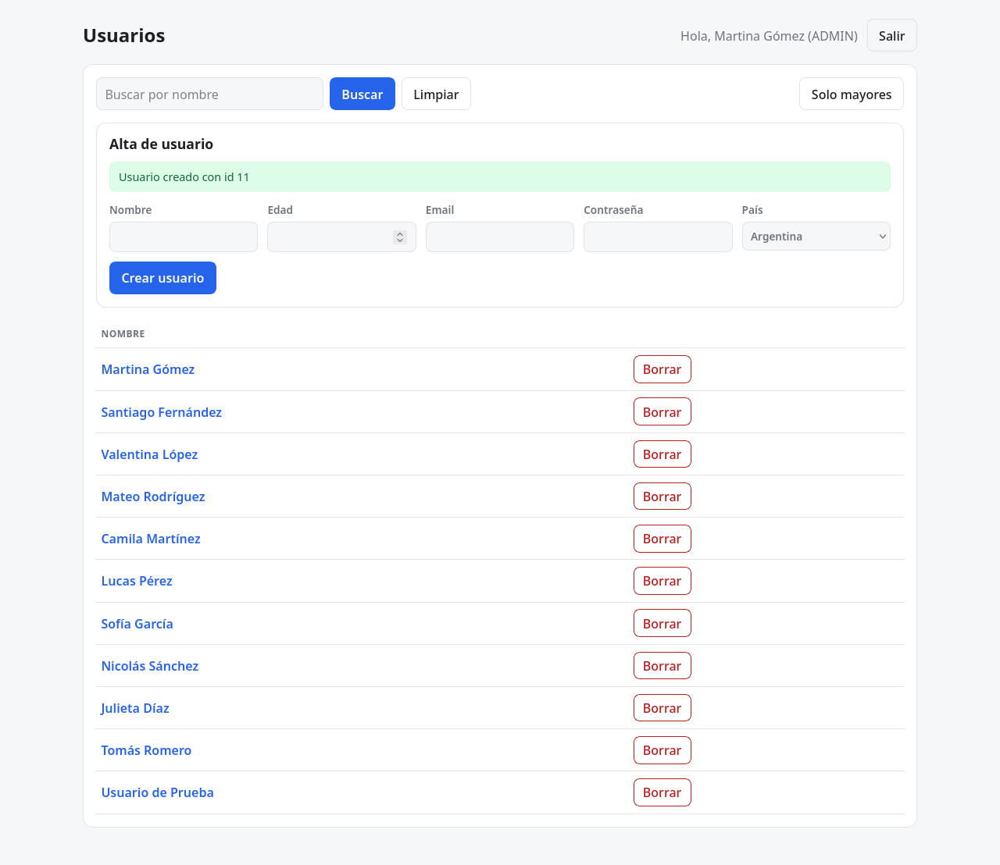
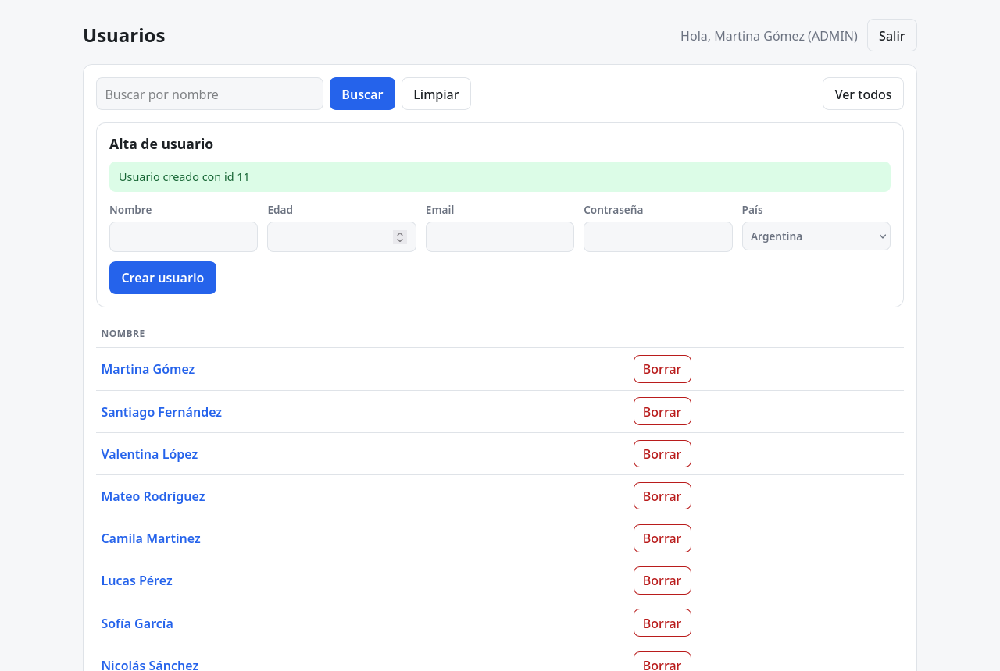
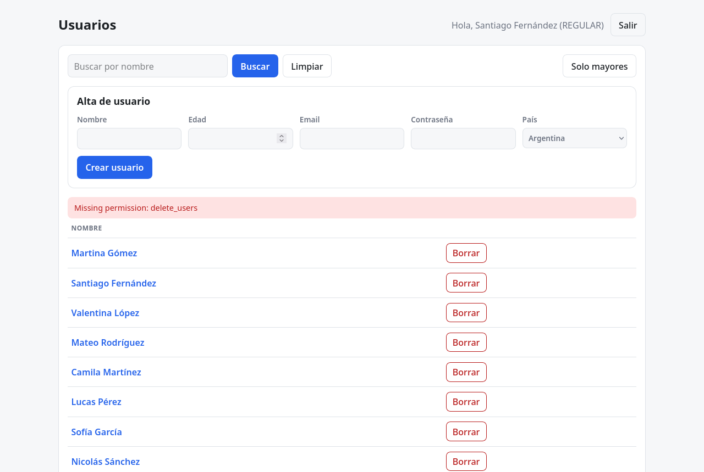

# TP2 — Frontend React + TypeScript

Trabajo Práctico 2 de Programación IV. Es una aplicación web que consume la API de
usuarios de la cátedra: login con token, listado, búsqueda, detalle, alta y borrado
de usuarios, con manejo de permisos, errores y sesión vencida.

Resuelve las Prácticas 1 a 9 de `practica-bk-endpoints.pdf` (incluida la 9, que es
de análisis y se responde al final de este documento).

## Requisitos

- Node.js 18 o superior (probado con Node 22).
- npm.
- La API de la cátedra corriendo en `http://localhost:8000` (ver abajo).

## Cómo correrlo

La aplicación necesita el backend funcionando: el frontend no tiene datos propios,
todo lo pide por HTTP.

**Terminal 1 — backend** (API de la cátedra, FastAPI + SQLite):

```bash
cd <carpeta-del-backend>
python3 -m venv .venv
source .venv/bin/activate
pip install -r requirements.txt
uvicorn main:app --reload
```

Queda escuchando en `http://127.0.0.1:8000`. En `http://127.0.0.1:8000/docs` se
puede ver la documentación de la API.

**Terminal 2 — frontend:**

```bash
cd app
npm install
npm run dev
```

Abrir la URL que imprime Vite (por defecto `http://localhost:5173`).

Si el backend está en otra dirección, copiar `app/.env.example` a `app/.env` y
cambiar `VITE_API_URL`.

### Usuarios de prueba

Todos usan la contraseña `123`.

| Email | Rol | Sirve para |
| --- | --- | --- |
| `mgomez@email.com` | ADMIN | Todo: listar, crear y borrar |
| `sfer@email.com` | REGULAR | Ver los 403 al crear y al borrar |

## Estructura

```
tp2-React/
├── practica-bk-endpoints.pdf    Enunciado de la práctica
├── README.md                    Este archivo
├── docs/capturas/               Capturas de pantalla de la aplicación
└── app/                         Proyecto React + TypeScript (Vite)
    ├── .env                     URL del backend (VITE_API_URL)
    ├── .env.example             Plantilla del .env
    ├── index.html               HTML base de la SPA
    ├── package.json             Dependencias y scripts
    ├── tsconfig*.json           Configuración de TypeScript
    ├── vite.config.ts           Configuración de Vite
    └── src/
        ├── main.tsx             Punto de entrada: monta <App /> en el DOM
        ├── App.tsx              Sesión: token, login/logout y saludo con roles
        ├── types.ts             Tipos de la API y funciones de formato
        ├── index.css            Estilos
        └── components/
            ├── Login.tsx        Formulario de ingreso (POST /login)
            ├── UserList.tsx     Lista, búsqueda, filtro de mayores y borrado
            ├── UserDetail.tsx   Detalle de un usuario (GET /user/{id})
            └── UserForm.tsx     Alta de usuario (POST /user)
```

### Para qué sirve cada archivo

- **`App.tsx`**: guarda el token en `localStorage`, decide si se muestra el login o
  la lista, arma el saludo `Hola, Martina Gómez (ADMIN)` y, si cualquier pedido
  responde 401, cierra la sesión y vuelve al login con "Tu sesión venció".
- **`types.ts`**: interfaces de la API (`User`, `UserDetail`, `Role`, `Country`) y
  ayudantes para mostrar roles y país y para leer el `detail` de los errores.
- **`UserList.tsx`**: el componente principal. Pide la lista, guarda el usuario
  seleccionado, busca por nombre, alterna entre todos y mayores de edad, y borra.
- **`UserDetail.tsx`**: pide `GET /user/{id}` cuando cambia el usuario elegido.
- **`UserForm.tsx`**: formulario de alta; al terminar avisa a `UserList` para que
  refresque la lista sin recargar la página.

## Cómo usarlo

1. **Ingresar** con `mgomez@email.com` / `123`. Arriba a la derecha aparece el
   saludo con nombre y rol.
2. **Ver el detalle**: hacer clic en el nombre de un usuario. A la derecha se
   muestran email, edad, país y roles. Se cierra con "Cerrar".
3. **Buscar**: escribir parte de un nombre (por ejemplo `ma`) y tocar "Buscar".
   "Limpiar" vuelve a la lista completa.
4. **Solo mayores**: el botón alterna entre todos los usuarios y los mayores de 18.
5. **Crear**: completar el formulario de alta (nombre, edad, email, contraseña y
   país) y tocar "Crear usuario". La lista se actualiza sola y se muestra el id
   que devuelve la API.
6. **Borrar**: botón "Borrar" en cada fila, con confirmación del navegador.
7. **Probar errores**: entrar como `sfer@email.com` y intentar crear o borrar;
   la API responde 403 y el mensaje se muestra en pantalla.
8. **Probar sesión vencida**: en DevTools → Application → Local Storage, cambiar
   una letra del token y recargar. Vuelve al login con "Tu sesión venció".

## Capturas

**Inicio de sesión**



**Listado con saludo, roles y formulario de alta**



**Detalle de un usuario**



**Búsqueda por nombre**



**Alta de usuario**



**Solo mayores: el usuario de 16 años no aparece**



**Error 403 al intentar borrar con un usuario sin permiso**



## API que consume

| Acción | Endpoint | Respuesta |
| --- | --- | --- |
| Login | `POST /login` `{ email, password }` | `{ msg, token }` |
| Usuario logueado | `GET /user/me/id` | `{ id }` |
| Lista | `GET /user` | `[{ id, name }]` |
| Búsqueda | `GET /user/search/{name}` | usuarios |
| Mayores | `GET /user_mayores` | usuarios |
| Detalle | `GET /user/{id}` | `{ id, name, email, age, country, roles }` |
| Alta | `POST /user` | `{ id }` |
| Borrado | `DELETE /user/{id}` | `{ msg }` o 403 |

Los errores se leen de `{ "detail": "..." }`. Un 401 en cualquier pedido cierra
la sesión y vuelve al login con el mensaje "Tu sesión venció".

## Scripts

```bash
npm run dev      # servidor de desarrollo
npm run build    # compila TypeScript y genera dist/
npm run preview  # sirve la versión compilada
npm run lint     # analiza el código
```
